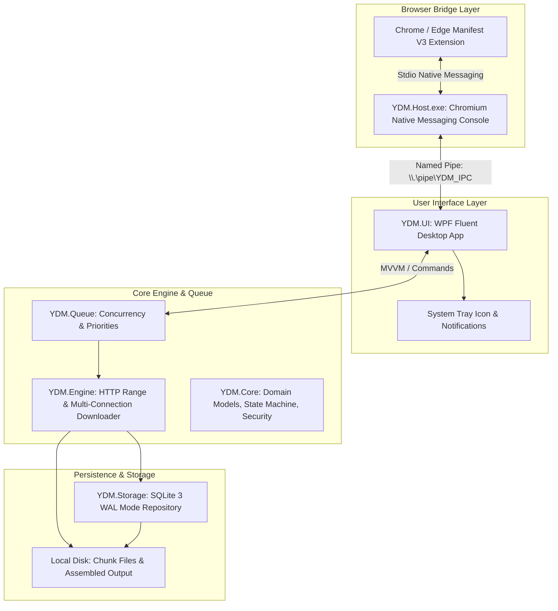

# YDM Implementation Decisions & Architecture Rationale

**Document Version:** 2.0.0  
**Project:** YDM (Your Download Manager)  
**Date:** October 2026  
**Status:** Approved for Implementation  

---

## 1. Architectural Overview & Design Principles

YDM is designed as an independent, modular, open-source download manager for Windows 10/11 x64. The architecture strictly decouples the domain entities and network protocols from persistent storage and the user interface.

---

## 2. Key Architectural Decisions

### DEC-01: Runtime Platform & Framework (.NET 8.0 LTS WPF)
- **Decision:** Target C# 12 and .NET 8.0 LTS utilizing WPF (`Microsoft.NET.Sdk` with `<UseWPF>true</UseWPF>`).
- **Rationale:**
  - .NET 8 provides long-term support (LTS), outstanding performance, and native modern networking primitives (`SocketsHttpHandler`).
  - WPF offers proven maturity on Windows 10 and 11, robust asynchronous data binding, comprehensive hardware-accelerated 2D rendering for segment visualizers, and eliminates external WinUI/AppSDK runtime installation headaches.
  - Deployment can be published as self-contained or framework-dependent.

### DEC-02: Persistence Mechanism (SQLite 3 with WAL Mode)
- **Decision:** Adopt `Microsoft.Data.Sqlite` with Write-Ahead Logging (`PRAGMA journal_mode=WAL;`).
- **Rationale:**
  - Unlike legacy IDM which stores state across thousands of Windows Registry keys, SQLite ensures ACID transactional safety, zero registry clutter, and corruption-free state checkpointing during abrupt system reboots or power loss.
  - WAL mode allows concurrent readers and writers without blocking download threads.

### DEC-03: HTTP Download Engine Architecture
- **Decision:** Standard RFC 7233 / RFC 9110 HTTP Range multi-segment engine with dynamic chunk allocation.
- **Rules:**
  1. **Pre-flight Probe:** Check remote resource support via `HEAD` or small `Range: bytes=0-0` request.
  2. **Range Validation:** If server returns `206 Partial Content` with valid `Content-Range`, enable multi-connection mode. If server returns `200 OK`, fall back to a single uninterrupted stream.
  3. **Resume Verification:** Store `ETag` and `Last-Modified`. On resume, issue conditional request (`If-Range: <ETag>`). If content modified, invalidate partial segments and restart from 0%.
  4. **Dynamic Chunk Midpoint Splitting:** For resumable downloads with multiple connections, the largest active incomplete segment with remaining bytes exceeding the minimum split threshold (2 MB) is split at its midpoint:
     $$\text{Midpoint} = \text{CurrentOffset} + \left\lfloor \frac{\text{EndOffset} - \text{CurrentOffset}}{2} \right\rfloor$$
  5. **Assembly:** When all segment workers complete, sequentially stream chunks into the final destination file, verify file size and hash, and safely delete temporary segment files.

### DEC-04: Security and Privacy Safeguards
- **Decision:** Zero-leakage privacy model and strict path sanitization.
- **Rules:**
  1. **No Bulk Cookie Harvesting:** Never extract or transmit the entire browser cookie store. Only send domain-specific cookies when explicitly downloading through browser integration.
  2. **No Credential Logging:** Sanitize logs so `Authorization`, `Cookie`, and `Set-Cookie` headers are never printed.
  3. **Strict Path Sanitization:** Remove all relative path components (`..`), directory separators (`/`, `\`), illegal characters (`: * ? " < > |`), and reserved DOS device names (`CON`, `PRN`, `AUX`, `NUL`, `COM1-9`, `LPT1-9`).
  4. **Zone.Identifier:** Attach NTFS alternate data stream `Zone.Identifier` (`ZoneId=3`) to indicate internet origin for Windows Defender and SmartScreen.
  5. **No Auto-Run:** YDM will never execute downloaded files without explicit user interaction.

### DEC-05: Chromium Manifest V3 Browser Extension Architecture
- **Decision:** Lightweight MV3 extension utilizing Native Messaging stdio framing.
- **Rules:**
  1. **Minimal Permissions:** Scoped to `downloads`, `nativeMessaging`, `storage`, and `contextMenus`.
  2. **Non-destructive Interception:** Interception requests are sent to `YDM.Host`. The browser download is canceled **only after** YDM acknowledges successful job acceptance.
  3. **Configurable Interception:** The user can enable or disable automatic browser interception from the extension popup or options page at any time.

### DEC-06: Queue & Scheduling Architecture
- **Decision:** `DownloadQueueManager` utilizing `SemaphoreSlim` for concurrency throttling and `Channel<T>` for asynchronous job queuing.
- **Rules:**
  1. Configurable max simultaneous active downloads (default: 2; range: 1 to 10).
  2. Independent download priorities (`High`, `Normal`, `Low`).
  3. Queue state persists across application restarts in SQLite.

---

## 3. Dependency Pinning & Compatibility Matrix

| Package Name | Version | License | Purpose |
|:---|:---|:---|:---|
| `Microsoft.Data.Sqlite` | `8.0.10` | MIT | SQLite database operations |
| `CommunityToolkit.Mvvm` | `8.3.2` | MIT | MVVM observable properties and relay commands |
| `Microsoft.Extensions.Logging` | `8.0.1` | MIT | Structured logging framework |
| `Microsoft.Extensions.Logging.Console` | `8.0.1` | MIT | Console logging provider |
| `System.Text.Json` | `8.0.5` | MIT | High-performance JSON serialization |
| `xunit` | `2.9.2` | Apache-2.0 | Unit testing framework |
| `xunit.runner.visualstudio` | `2.8.2` | Apache-2.0 | Visual Studio / `dotnet test` runner |
| `Microsoft.NET.Test.Sdk` | `17.11.1` | MS-EULA / MIT | .NET test execution host |

All dependencies are officially supported by Microsoft, pinned to stable releases, and free from licensing conflicts.
