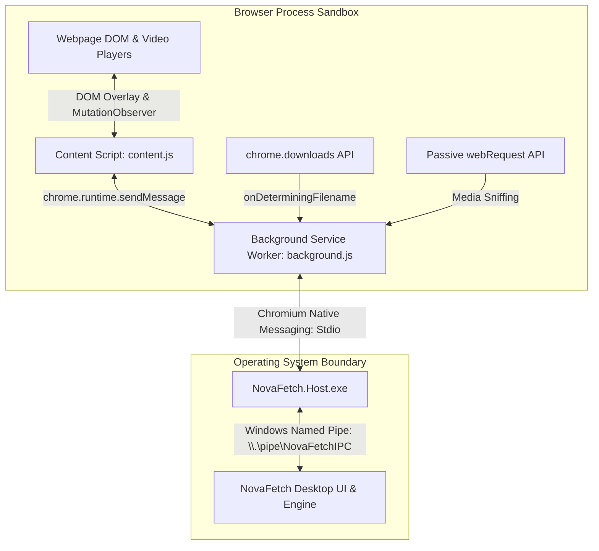

# Browser Integration & Native Messaging Specification

**Project:** NovaFetch (Original Windows Download Manager)  
**Document:** Browser Integration Architecture & Protocol Specification  
**Target Browsers:** Google Chrome, Microsoft Edge, Brave, Vivaldi, Opera (Chromium-based)  
**Standard Architecture:** Chromium Manifest V3 (MV3) & Chromium Native Messaging  

---

## 1. Subsystem Architecture Overview

To provide seamless, automatic download interception and in-browser video capture, NovaFetch utilizes a tri-tier architecture strictly compliant with modern browser security sandboxes.



---

## 2. Manifest V3 Extension Configuration

### 2.1 Extension `manifest.json`
```json
{
  "manifest_version": 3,
  "name": "NovaFetch Integration Module",
  "version": "1.0.0",
  "description": "Seamless high-speed download interception and media capture for NovaFetch.",
  "permissions": [
    "downloads",
    "nativeMessaging",
    "cookies",
    "webRequest",
    "storage",
    "contextMenus"
  ],
  "host_permissions": [
    "<all_urls>"
  ],
  "background": {
    "service_worker": "background.js",
    "type": "module"
  },
  "content_scripts": [
    {
      "matches": ["<all_urls>"],
      "js": ["content.js"],
      "css": ["panel.css"],
      "run_at": "document_end",
      "all_frames": true
    }
  ],
  "action": {
    "default_popup": "popup.html",
    "default_icon": {
      "16": "icons/icon16.png",
      "48": "icons/icon48.png",
      "128": "icons/icon128.png"
    }
  },
  "icons": {
    "16": "icons/icon16.png",
    "48": "icons/icon48.png",
    "128": "icons/icon128.png"
  }
}
```

---

## 3. Chromium Native Messaging Protocol

### 3.1 Host Manifest (`org.novafetch.bridge.json`)
The Native Messaging Host is defined by a JSON manifest located on the local disk:

```json
{
  "name": "org.novafetch.bridge",
  "description": "NovaFetch Native Messaging Host Bridge",
  "path": "C:\\Program Files\\NovaFetch\\NovaFetch.Host.exe",
  "type": "stdio",
  "allowed_origins": [
    "chrome-extension://[EXTENSION_ID_PLACEHOLDER]/"
  ]
}
```

### 3.2 Windows Registry Registration
To register the host with Chromium-based browsers, registry entries must be written to the `CurrentVersion` or `NativeMessagingHosts` keys:

#### Google Chrome:
* **Registry Path:** `HKEY_CURRENT_USER\Software\Google\Chrome\NativeMessagingHosts\org.novafetch.bridge`
* **Default Value:** `C:\Program Files\NovaFetch\org.novafetch.bridge.json`

#### Microsoft Edge:
* **Registry Path:** `HKEY_CURRENT_USER\Software\Microsoft\Edge\NativeMessagingHosts\org.novafetch.bridge`
* **Default Value:** `C:\Program Files\NovaFetch\org.novafetch.bridge.json`

### 3.3 Framing Protocol & Wire Format
Native messaging over standard input/output (`stdio`) uses binary framing:
* Each message begins with a **32-bit unsigned little-endian integer** indicating the length of the following JSON message in bytes.
* The message itself is a UTF-8 encoded JSON string (maximum length: 1,048,576 bytes / 1 MB).

```text
[Byte 0-3: uint32 LE Message Length (N)] [Byte 4 to 4+N: UTF-8 JSON Payload]
```

### 3.4 C# Stdio Bridge Implementation (`NovaFetch.Host`)

```csharp
namespace NovaFetch.Host;

public class NativeMessagingHost
{
    public static async Task Main(string[] args)
    {
        using var stdin = Console.OpenStandardInput();
        using var stdout = Console.OpenStandardOutput();
        using var reader = new BinaryReader(stdin);
        using var writer = new BinaryWriter(stdout);

        while (true)
        {
            try
            {
                // Read 32-bit uint length prefix
                if (stdin.ReadByte() is var firstByte && firstByte == -1) break;
                
                byte[] lengthBytes = new byte[4];
                lengthBytes[0] = (byte)firstByte;
                reader.Read(lengthBytes, 1, 3);
                uint messageLength = BitConverter.ToUInt32(lengthBytes, 0);

                if (messageLength == 0 || messageLength > 1024 * 1024) break;

                // Read UTF-8 payload
                byte[] messageBuffer = reader.ReadBytes((int)messageLength);
                string jsonString = Encoding.UTF8.GetString(messageBuffer);

                // Forward message to desktop application via Named Pipe
                string responseJson = await ForwardToDesktopAppAsync(jsonString);

                // Send response back to browser
                byte[] responseBytes = Encoding.UTF8.GetBytes(responseJson);
                writer.Write((uint)responseBytes.Length);
                writer.Write(responseBytes);
                writer.Flush();
            }
            catch (EndOfStreamException)
            {
                break; // Browser closed stdio channel
            }
            catch (Exception ex)
            {
                LogError(ex);
                break;
            }
        }
    }
}
```

---

## 4. Message Schemas

### 4.1 Download Interception Message (`intercept_download`)

#### Browser to Host (Request):
```json
{
  "action": "intercept_download",
  "downloadId": 1042,
  "url": "https://releases.ubuntu.com/24.04/ubuntu-24.04-desktop-amd64.iso",
  "fileName": "ubuntu-24.04-desktop-amd64.iso",
  "fileSize": 6128000000,
  "mimeType": "application/x-iso9660-image",
  "referrer": "https://releases.ubuntu.com/",
  "userAgent": "Mozilla/5.0 (Windows NT 10.0; Win64; x64) AppleWebKit/537.36...",
  "cookies": "session_id=abc123xyz; secure_token=987654",
  "customHeaders": {
    "Accept": "*/*",
    "Sec-Fetch-Mode": "navigate"
  }
}
```

#### Host to Browser (Response):
```json
{
  "status": "success",
  "action": "intercept_ack",
  "intercepted": true,
  "jobId": "f47ac10b-58cc-4372-a567-0e02b2c3d479",
  "message": "Download successfully claimed by NovaFetch."
}
```

---

## 5. Download Interception Workflow (Manifest V3)

```javascript
// background.js (Chrome MV3 Service Worker)
let nativePort = null;

function connectNativeHost() {
  nativePort = chrome.runtime.connectNative("org.novafetch.bridge");
  nativePort.onDisconnect.addListener(() => {
    console.warn("Native host disconnected:", chrome.runtime.lastError?.message);
    nativePort = null;
  });
}

// Listen to browser download requests before filename determination
chrome.downloads.onDeterminingFilename.addListener((downloadItem, suggest) => {
  // Check if file extension is intercepted by NovaFetch
  const fileExt = downloadItem.filename.split('.').pop()?.toUpperCase() || "";
  const interceptedExtensions = ["ZIP", "ISO", "EXE", "MP4", "MKV", "TAR", "GZ", "PDF"];

  if (interceptedExtensions.includes(fileExt)) {
    // Intercept with NovaFetch
    if (!nativePort) connectNativeHost();

    chrome.cookies.getAll({ url: downloadItem.url }, (cookies) => {
      const cookieHeader = cookies.map(c => `${c.name}=${c.value}`).join("; ");

      const payload = {
        action: "intercept_download",
        downloadId: downloadItem.id,
        url: downloadItem.url,
        fileName: downloadItem.filename,
        fileSize: downloadItem.fileSize,
        mimeType: downloadItem.mime,
        referrer: downloadItem.referrer,
        userAgent: navigator.userAgent,
        cookies: cookieHeader
      };

      nativePort.postMessage(payload);

      // Cancel the browser's native download
      chrome.downloads.cancel(downloadItem.id, () => {
        chrome.downloads.erase({ id: downloadItem.id });
      });
    });
  } else {
    // Allow standard browser download
    suggest();
  }
  return true; // Keep callback channel open
});
```

---

## 6. Video & Streaming Media Capture

### 6.1 Media Format Categorization & Handling

| Media Delivery Archetype | Detection Mechanism | NovaFetch Capture Strategy | Compatibility & Legal Boundary |
|:---|:---|:---|:---|
| **Direct Media Files** (`.mp4`, `.webm`, `.mp3`) | Passive `webRequest` or `<video src="...">` | Standard multi-segment HTTP Range download engine. | 100% standard; fully supported. |
| **HTTP Live Streaming (HLS)** (`.m3u8` playlists) | Passive inspection of `Content-Type: application/vnd.apple.mpegurl` | Fetch master & media playlists; download `.ts` chunks concurrently; mux to MP4. | Supported for unencrypted streams. |
| **MPEG-DASH** (`.mpd` manifests) | Passive inspection of `Content-Type: application/dash+xml` | Parse XML manifest; identify video & audio representation bitrates; mux streams. | Supported for unencrypted streams. |
| **Adaptive Split Streams** (e.g. YouTube 1080p+) | Browser sniffs separate audio (`mp4a`) & video (`avc1`/`vp9`) streams | Download high-res video chunk + audio chunk in parallel; mux via FFmpeg CLI. | Fully supported for public content. |
| **DRM Protected Content** (Widevine, FairPlay, PlayReady) | Detection of EME `navigator.requestMediaKeySystemAccess` | **Explicit Refusal:** Present polite notification: *"Protected Stream (DRM) cannot be downloaded."* | Strict legal boundary: No DRM bypass. |

### 6.2 Floating Video Download Panel (Content Script)

```javascript
// content.js - Injected into webpage
document.addEventListener("play", (event) => {
  const mediaElement = event.target;
  if (mediaElement.tagName === "VIDEO" || mediaElement.tagName === "AUDIO") {
    injectDownloadPanel(mediaElement);
  }
}, true);

function injectDownloadPanel(videoEl) {
  if (videoEl.dataset.novafetchPanelInjected) return;
  videoEl.dataset.novafetchPanelInjected = "true";

  const panel = document.createElement("div");
  panel.className = "novafetch-video-panel";
  panel.innerHTML = `
    <button class="novafetch-btn">
      <svg width="14" height="14" viewBox="0 0 24 24"><path fill="currentColor" d="M19 9h-4V3H9v6H5l7 7 7-7zM5 18v2h14v-2H5z"/></svg>
      Download Video
    </button>
  `;

  panel.querySelector("button").addEventListener("click", (e) => {
    e.stopPropagation();
    const mediaSrc = videoEl.currentSrc || videoEl.src;
    chrome.runtime.sendMessage({
      action: "capture_media_stream",
      src: mediaSrc,
      pageTitle: document.title,
      pageUrl: window.location.href
    });
  });

  // Position overlay above video element
  positionOverlay(panel, videoEl);
  document.body.appendChild(panel);
}
```

---

## 7. Failure Handling & Resilience

1. **Native Host Not Found / Unregistered:**
   * If `chrome.runtime.connectNative` fails with `Specified native messaging host not found`, the browser extension flags an unobtrusive icon badge (`!`). Clicking the extension popup displays a direct link: *"NovaFetch desktop application is not running or native bridge is unregistered. Click here to repair."*
2. **Desktop Application Closed:**
   * `NovaFetch.Host.exe` will attempt to launch `NovaFetch.exe` in the background with the `/minimized` flag if the desktop UI is not currently active, ensuring downloads are not lost.
3. **Session Cookies & Authentication:**
   * When capturing downloads requiring site authentication, the extension queries `chrome.cookies.getAll` for the target URL's domain and attaches the full cookie jar to the native request payload, ensuring zero 403 Forbidden errors.
