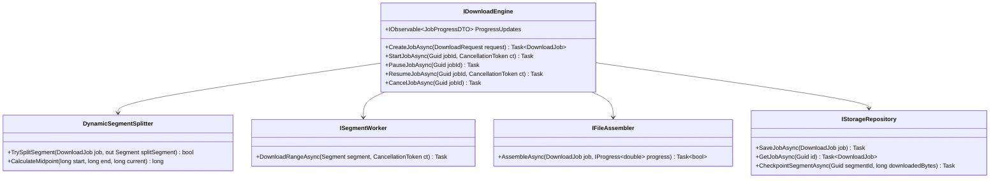
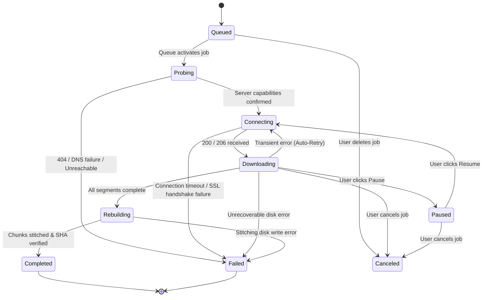

# NovaFetch Download Engine: Technical Specification & Protocol Guide

**Project:** NovaFetch (Original Windows Download Manager)  
**Document:** Download Engine Specification  
**Language & Runtime:** C# 12 / .NET 8 LTS (or .NET 9)  
**Standard Compliance:** RFC 9110 (HTTP Semantics), RFC 7233 (Range Requests), RFC 6266 (Content-Disposition)  

---

## 1. System Architecture & Module Boundaries

The download engine is decoupled from the user interface and operating system shell. It operates as an asynchronous, stateful, event-driven subsystem.



---

## 2. Core Domain Models & Interfaces

### 2.1 Core C# Interfaces

```csharp
namespace NovaFetch.Core.Interfaces;

public interface IDownloadEngine
{
    Task<DownloadJob> QueueDownloadAsync(DownloadRequest request, CancellationToken ct = default);
    Task StartAsync(Guid jobId, CancellationToken ct = default);
    Task PauseAsync(Guid jobId);
    Task ResumeAsync(Guid jobId, CancellationToken ct = default);
    Task CancelAsync(Guid jobId);
    Task RemoveAsync(Guid jobId, bool deleteFiles);
    
    event EventHandler<JobProgressEventArgs> OnProgressUpdated;
    event EventHandler<JobStateChangedEventArgs> OnStateChanged;
}

public interface ISegmentDownloader
{
    Task ExecuteAsync(
        DownloadJob job, 
        DownloadSegment segment, 
        HttpClient client, 
        IProgress<long> bytesReadProgress, 
        CancellationToken ct);
}

public interface IFileAssembler
{
    Task<string> AssembleSegmentsAsync(
        DownloadJob job, 
        string targetDirectory, 
        IProgress<double> assemblyProgress, 
        CancellationToken ct);
}

public interface IHttpProbeService
{
    Task<ProbeResult> ProbeUrlAsync(
        Uri url, 
        IDictionary<string, string>? customHeaders = null, 
        CancellationToken ct = default);
}
```

### 2.2 Download Job & Segment Data Models

```csharp
namespace NovaFetch.Core.Models;

public enum JobStatus
{
    Queued,
    Probing,
    Connecting,
    Downloading,
    Paused,
    Rebuilding,
    Completed,
    Failed,
    Canceled
}

public class DownloadJob
{
    public Guid Id { get; set; } = Guid.NewGuid();
    public string Url { get; set; } = string.Empty;
    public string? Referrer { get; set; }
    public string? Cookies { get; set; }
    public string? UserAgent { get; set; }
    
    public string FileName { get; set; } = string.Empty;
    public string DestinationPath { get; set; } = string.Empty;
    public string TempDirectory { get; set; } = string.Empty;
    
    public long? TotalBytes { get; set; }
    public long DownloadedBytes { get; set; }
    public bool IsResumable { get; set; }
    public string? ETag { get; set; }
    public DateTimeOffset? LastModified { get; set; }
    
    public JobStatus Status { get; set; } = JobStatus.Queued;
    public int MaxConnections { get; set; } = 8;
    public List<DownloadSegment> Segments { get; set; } = new();
    
    public DateTime CreatedAt { get; set; } = DateTime.UtcNow;
    public DateTime? CompletedAt { get; set; }
    public string? LastErrorMessage { get; set; }
}

public class DownloadSegment
{
    public Guid Id { get; set; } = Guid.NewGuid();
    public Guid JobId { get; set; }
    public int Index { get; set; }
    
    public long StartOffset { get; set; }
    public long EndOffset { get; set; }
    public long CurrentOffset { get; set; }
    
    public string TempFilePath { get; set; } = string.Empty;
    public bool IsCompleted => CurrentOffset >= EndOffset && EndOffset > 0;
    public bool IsActive { get; set; }
    
    public long RemainingBytes => (EndOffset > 0) ? (EndOffset - CurrentOffset + 1) : -1;
}
```

---

## 3. Download Job State Machine



---

## 4. Critical Algorithms & Pseudocode

### 4.1 Algorithm 1: Pre-Flight HTTP Probe & Range Negotiation
```csharp
public async Task<ProbeResult> ProbeUrlAsync(Uri url, IDictionary<string, string>? headers, CancellationToken ct)
{
    using var request = new HttpRequestMessage(HttpMethod.Get, url);
    request.Headers.Range = new RangeItemHeaderValue(0, 0); // Probe first byte
    
    if (headers != null)
    {
        foreach (var kvp in headers)
            request.Headers.TryAddWithoutValidation(kvp.Key, kvp.Value);
    }

    using var response = await _httpClient.SendAsync(
        request, 
        HttpCompletionOption.ResponseHeadersRead, 
        ct);

    if (!response.IsSuccessStatusCode && response.StatusCode != HttpStatusCode.PartialContent)
    {
        throw new HttpRequestException($"Server returned error code: {response.StatusCode}");
    }

    bool isResumable = false;
    long? totalBytes = null;

    if (response.StatusCode == HttpStatusCode.PartialContent)
    {
        // 206 Partial Content confirms range support
        isResumable = true;
        if (response.Content.Headers.ContentRange?.Length.HasValue == true)
        {
            totalBytes = response.Content.Headers.ContentRange.Length.Value;
        }
    }
    else if (response.StatusCode == HttpStatusCode.OK)
    {
        // Server ignored Range header and sent full content
        isResumable = false;
        totalBytes = response.Content.Headers.ContentLength;
    }

    string fileName = ExtractFileName(response, url);
    string? etag = response.Headers.ETag?.Tag;
    DateTimeOffset? lastModified = response.Content.Headers.LastModified;

    return new ProbeResult(fileName, totalBytes, isResumable, etag, lastModified);
}
```

### 4.2 Algorithm 2: Dynamic Mid-Point In-Flight Segmentation
```csharp
public bool TrySplitLargestActiveSegment(DownloadJob job, out DownloadSegment? newSegment)
{
    newSegment = null;
    const long MIN_SPLIT_THRESHOLD = 512 * 1024; // 512 KB minimum chunk to split

    lock (job.Segments)
    {
        if (job.Segments.Count >= job.MaxConnections)
            return false;

        // Find the active downloading segment with the largest remaining byte delta
        var targetSegment = job.Segments
            .Where(s => s.IsActive && !s.IsCompleted && s.RemainingBytes > (MIN_SPLIT_THRESHOLD * 2))
            .OrderByDescending(s => s.RemainingBytes)
            .FirstOrDefault();

        if (targetSegment == null)
            return false;

        // Calculate exact midpoint
        long remaining = targetSegment.EndOffset - targetSegment.CurrentOffset;
        long midPoint = targetSegment.CurrentOffset + (remaining / 2);

        // Create new segment covering the upper half
        newSegment = new DownloadSegment
        {
            Id = Guid.NewGuid(),
            JobId = job.Id,
            Index = job.Segments.Count,
            StartOffset = midPoint,
            CurrentOffset = midPoint,
            EndOffset = targetSegment.EndOffset,
            TempFilePath = Path.Combine(job.TempDirectory, $"segment_{job.Segments.Count}.tmp"),
            IsActive = true
        };

        // Truncate the original segment to end at midpoint - 1
        targetSegment.EndOffset = midPoint - 1;

        job.Segments.Add(newSegment);
        return true;
    }
}
```

### 4.3 Algorithm 3: Segment Download Worker & Throttling Loop
```csharp
public async Task DownloadSegmentRangeAsync(
    DownloadJob job, 
    DownloadSegment segment, 
    HttpClient client, 
    IProgress<long> progress, 
    CancellationToken ct)
{
    using var request = new HttpRequestMessage(HttpMethod.Get, job.Url);
    request.Headers.Range = new RangeItemHeaderValue(segment.CurrentOffset, segment.EndOffset);

    if (!string.IsNullOrEmpty(job.ETag))
        request.Headers.IfRange = new RangeConditionHeaderValue(job.ETag);

    using var response = await client.SendAsync(request, HttpCompletionOption.ResponseHeadersRead, ct);
    response.EnsureSuccessStatusCode();

    using var networkStream = await response.Content.ReadAsStreamAsync(ct);
    using var fileStream = new FileStream(
        segment.TempFilePath, 
        FileMode.OpenOrCreate, 
        FileAccess.Write, 
        FileShare.None, 
        bufferSize: 64 * 1024, 
        useAsync: true);

    fileStream.Seek(fileStream.Length, SeekOrigin.Begin);

    byte[] buffer = new byte[32 * 1024];
    int bytesRead;

    while ((bytesRead = await networkStream.ReadAsync(buffer, 0, buffer.Length, ct)) > 0)
    {
        await fileStream.WriteAsync(buffer, 0, bytesRead, ct);
        segment.CurrentOffset += bytesRead;
        progress.Report(bytesRead);

        if (segment.CurrentOffset > segment.EndOffset && segment.EndOffset > 0)
            break;
    }

    await fileStream.FlushAsync(ct);
    segment.IsActive = false;
}
```

### 4.4 Algorithm 4: Sequential Assembly & Atomic Finalization
```csharp
public async Task<string> AssembleSegmentsAsync(DownloadJob job, string finalDestinationPath, CancellationToken ct)
{
    job.Status = JobStatus.Rebuilding;
    string tempOutputFile = finalDestinationPath + ".rebuilding";

    // Sort segments by their starting offset
    var sortedSegments = job.Segments.OrderBy(s => s.StartOffset).ToList();

    using (var outputStream = new FileStream(
        tempOutputFile, 
        FileMode.Create, 
        FileAccess.Write, 
        FileShare.None, 
        bufferSize: 1024 * 1024, 
        useAsync: true))
    {
        byte[] buffer = new byte[1024 * 1024]; // 1 MB buffer for fast sequential stitching

        foreach (var segment in sortedSegments)
        {
            if (!File.Exists(segment.TempFilePath))
                throw new FileNotFoundException($"Missing temporary segment file: {segment.TempFilePath}");

            using (var segmentStream = new FileStream(
                segment.TempFilePath, 
                FileMode.Open, 
                FileAccess.Read, 
                FileShare.Read, 
                bufferSize: 1024 * 1024, 
                useAsync: true))
            {
                int bytesRead;
                while ((bytesRead = await segmentStream.ReadAsync(buffer, 0, buffer.Length, ct)) > 0)
                {
                    await outputStream.WriteAsync(buffer, 0, bytesRead, ct);
                }
            }
        }
        await outputStream.FlushAsync(ct);
    }

    // Atomic Move / Replacement
    if (File.Exists(finalDestinationPath))
        File.Delete(finalDestinationPath);

    File.Move(tempOutputFile, finalDestinationPath);

    // Clean up temporary chunk directory
    try
    {
        if (Directory.Exists(job.TempDirectory))
            Directory.Delete(job.TempDirectory, recursive: true);
    }
    catch (Exception ex)
    {
        Log.Warning("Failed to clean up temp directory {Dir}: {Message}", job.TempDirectory, ex.Message);
    }

    job.Status = JobStatus.Completed;
    job.CompletedAt = DateTime.UtcNow;
    return finalDestinationPath;
}
```

### 4.5 Algorithm 5: Rolling EWMA Transfer Rate Estimation
```csharp
public class SpeedCalculator
{
    private readonly double _alpha; // Smoothing factor (default 0.25)
    private double _smoothedSpeed;
    private long _bytesSinceLastTick;
    private DateTime _lastTickTime = DateTime.UtcNow;

    public SpeedCalculator(double alpha = 0.25) => _alpha = alpha;

    public void AddBytes(long bytes) => Interlocked.Add(ref _bytesSinceLastTick, bytes);

    public double Tick()
    {
        var now = DateTime.UtcNow;
        double elapsedSeconds = (now - _lastTickTime).TotalSeconds;
        if (elapsedSeconds <= 0.05) return _smoothedSpeed;

        long bytes = Interlocked.Exchange(ref _bytesSinceLastTick, 0);
        double instantSpeed = bytes / elapsedSeconds; // Bytes per second

        if (_smoothedSpeed <= 0)
            _smoothedSpeed = instantSpeed;
        else
            _smoothedSpeed = (_alpha * instantSpeed) + ((1 - _alpha) * _smoothedSpeed);

        _lastTickTime = now;
        return _smoothedSpeed;
    }

    public TimeSpan EstimateRemainingTime(long remainingBytes)
    {
        if (_smoothedSpeed <= 0 || remainingBytes <= 0)
            return TimeSpan.MaxValue;

        return TimeSpan.FromSeconds(remainingBytes / _smoothedSpeed);
    }
}
```

---

## 5. Storage & Persistence Schema (SQLite)

NovaFetch utilizes SQLite in WAL (Write-Ahead Logging) mode to guarantee transactional persistence:

```sql
CREATE TABLE IF NOT EXISTS Downloads (
    Id TEXT PRIMARY KEY,
    Url TEXT NOT NULL,
    Referrer TEXT,
    Cookies TEXT,
    UserAgent TEXT,
    FileName TEXT NOT NULL,
    DestinationPath TEXT NOT NULL,
    TempDirectory TEXT NOT NULL,
    TotalBytes INTEGER,
    DownloadedBytes INTEGER NOT NULL DEFAULT 0,
    IsResumable INTEGER NOT NULL DEFAULT 1,
    ETag TEXT,
    LastModified TEXT,
    Status TEXT NOT NULL DEFAULT 'Queued',
    MaxConnections INTEGER NOT NULL DEFAULT 8,
    CreatedAt TEXT NOT NULL,
    CompletedAt TEXT,
    LastErrorMessage TEXT
);

CREATE TABLE IF NOT EXISTS Segments (
    Id TEXT PRIMARY KEY,
    JobId TEXT NOT NULL,
    SegmentIndex INTEGER NOT NULL,
    StartOffset INTEGER NOT NULL,
    EndOffset INTEGER NOT NULL,
    CurrentOffset INTEGER NOT NULL,
    TempFilePath TEXT NOT NULL,
    FOREIGN KEY(JobId) REFERENCES Downloads(Id) ON DELETE CASCADE
);

CREATE TABLE IF NOT EXISTS Settings (
    Key TEXT PRIMARY KEY,
    Value TEXT NOT NULL
);

CREATE INDEX IF NOT EXISTS IX_Segments_JobId ON Segments(JobId);
CREATE INDEX IF NOT EXISTS IX_Downloads_Status ON Downloads(Status);
```
