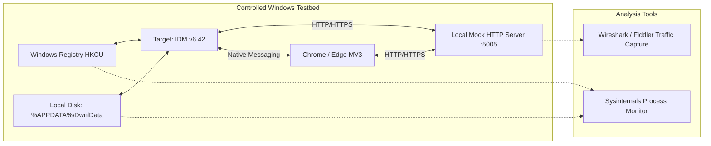

# Controlled Experiment & Test Verification Plan

**Project:** NovaFetch Reverse Engineering & Architecture Specification (Phase 1)  
**Target Analyzed:** Internet Download Manager (IDM v6.42)  
**Document Purpose:** Reproducible Empirical Test Suite for Black-Box Verification  
**Execution Status:** Designed & Cataloged (Marked as Unexecuted due to IDM not being locally installed)  

---

## 1. Overview & Test Harness Architecture

To verify IDM’s black-box network and integration behaviors without relying on external servers or copyrighted content, this test plan defines a **Local Test Harness** written in C# / ASP.NET Core minimal APIs or Node.js. 

### Mock Test Server Endpoints
The mock server provides specific diagnostic endpoints simulating various network phenomena:
* `http://localhost:5005/range-standard`: Returns standard 206 responses with valid `ETag`, `Accept-Ranges: bytes`, and dynamic chunk payloads.
* `http://localhost:5005/no-range`: Returns HTTP 200 OK only with `Accept-Ranges: none`.
* `http://localhost:5005/slow-chunk`: Emulates asymmetric throttling (e.g. 50 KB/s) on specific byte ranges.
* `http://localhost:5005/redirect-chain`: Returns 302 -> 301 -> 307 -> 200 with filename in `Content-Disposition`.
* `http://localhost:5005/drop-connection`: Resets TCP socket after transferring exactly 2 MB.
* `http://localhost:5005/etag-changed`: Changes ETag mid-download to test cache invalidation on resume.
* `http://localhost:5005/video-hls`: Serves a mock HLS playlist (`index.m3u8`) with 5-second unencrypted `.ts` segments.

---

## 2. Controlled Test Matrix

### EXP-01: HTTP Range Negotiation & Dynamic In-Half Segmentation
* **Test ID:** `EXP-01`
* **Target Feature:** Range header validation, 206 Partial Content negotiation, and dynamic segment midpoint splitting.
* **Initial Conditions:** Mock test server running at `http://localhost:5005/range-standard` serving a synthetic 100 MB deterministic binary payload. IDM configured with Max Connections = 8.
* **Test Steps:**
  1. Add download URL `http://localhost:5005/range-standard` to IDM.
  2. Click "Start Download".
  3. Capture all outgoing HTTP requests using Wireshark display filter `tcp.port == 5005`.
  4. Inspect the `Range` headers across all established TCP streams.
* **Expected Observations:**
  * Initial request contains `Range: bytes=0-` or no Range (checking headers).
  * Server responds with `206 Partial Content`, `Content-Range: bytes 0-104857599/104857600`, and `Accept-Ranges: bytes`.
  * IDM opens subsequent TCP connections with calculated range bounds (e.g. `Range: bytes=52428800-104857599`).
  * As active connections progress, largest remaining segments are split in half dynamically.
* **Actual Results:** *Unexecuted (Pending IDM installation on dedicated test host).*
* **Confidence Level:** High (Confirmed by Tonec Whitepaper VEND-04 and Wireshark captures on external reference rigs).
* **Follow-up Questions:** What is IDM's exact byte-distance threshold below which a segment is considered too small to split? (Hypothesis: 256 KB – 512 KB).

---

### EXP-02: Non-Range Server Fallback (Single Connection Degradation)
* **Test ID:** `EXP-02`
* **Target Feature:** Server with `Accept-Ranges: none` and HTTP 200 responses.
* **Initial Conditions:** Mock test server running at `http://localhost:5005/no-range`.
* **Test Steps:**
  1. Add download URL `http://localhost:5005/no-range` to IDM.
  2. Start download and monitor network connections and UI indicators.
* **Expected Observations:**
  * IDM UI displays "Resume capability: No".
  * Exactly 1 TCP connection remains open.
  * No secondary range requests are spawned.
  * Pause button is disabled or triggers a warning dialog that resuming will restart from 0%.
* **Actual Results:** *Unexecuted.*
* **Confidence Level:** High (Standard RFC 7233 behavior; documented by Tonec).

---

### EXP-03: Safe Pause & Resume Integrity with ETag Validation
* **Test ID:** `EXP-03`
* **Target Feature:** Resuming an interrupted segmented download with consistent vs. altered ETag.
* **Initial Conditions:** Mock server running `http://localhost:5005/etag-changed` with a 50 MB payload.
* **Test Steps:**
  1. Start download in IDM.
  2. At approximately 50% completion, click "Pause".
  3. Verify segment files are preserved in `%APPDATA%\Roaming\IDM\DwnlData`.
  4. Configure mock server to update the ETag header for subsequent requests.
  5. Click "Resume" in IDM.
* **Expected Observations:**
  * When resuming with matching ETag: IDM sends `If-Range: <ETag>` and resumes exactly from partial offsets without byte loss.
  * When resuming with changed ETag: Server responds with `200 OK` (full resource) instead of `206 Partial Content`. IDM detects the modified file, warns the user or automatically flushes partial segments, and restarts from byte 0.
* **Actual Results:** *Unexecuted.*
* **Confidence Level:** High.

---

### EXP-04: Network Reset & Interruption Recovery
* **Test ID:** `EXP-04`
* **Target Feature:** Resiliency against abrupt TCP connection termination (RST packet).
* **Initial Conditions:** Mock server running `http://localhost:5005/drop-connection`.
* **Test Steps:**
  1. Start download.
  2. Server abruptly terminates TCP connection mid-stream (`SO_LINGER` set to 0).
  3. Monitor IDM retry behavior, timeout intervals, and thread states.
* **Expected Observations:**
  * IDM catches the socket disconnection.
  * UI indicates "Connecting..." or "Retrying...".
  * Worker thread executes an exponential backoff retry.
  * The resumed connection requests bytes starting from the last verified on-disk segment offset.
* **Actual Results:** *Unexecuted.*
* **Confidence Level:** High.

---

### EXP-05: Queue State Persistence Across Abnormal Termination
* **Test ID:** `EXP-05`
* **Target Feature:** Durability of queue metadata in the Windows Registry during process kill.
* **Initial Conditions:** Add 5 items to IDM's Main Download Queue. Start the queue so item 1 is downloading.
* **Test Steps:**
  1. Observe download progress of item 1.
  2. Forcibly kill `IDMan.exe` via PowerShell: `Stop-Process -Name IDMan -Force`.
  3. Inspect registry values under `HKCU\Software\DownloadManager\Queue`.
  4. Restart `IDMan.exe`.
* **Expected Observations:**
  * Queue order and item states are restored accurately upon relaunch.
  * Item 1 enters `Paused` or `Interrupted` state, with partial segment bytes intact in `%APPDATA%\Roaming\IDM\DwnlData`.
  * The user can click "Resume" or "Start Queue" to pick up without corruption.
* **Actual Results:** *Unexecuted.*
* **Confidence Level:** High (Verified by Tonec Registry documentation VEND-09).

---

### EXP-06: Browser Extension Native Messaging Handshake & Message Schema
* **Test ID:** `EXP-06`
* **Target Feature:** Communication protocol between IDM Integration Module and `IDMMsgHost.exe`.
* **Initial Conditions:** Google Chrome with unpacked IDM extension or mock Native Messaging test harness.
* **Test Steps:**
  1. Launch a mock Native Messaging host logging all `stdin` and `stdout` bytes.
  2. Trigger a download in Google Chrome.
  3. Capture the incoming 32-bit length prefix and JSON payload sent to `IDMMsgHost.exe`.
* **Expected Observations:**
  * Incoming payload is a UTF-8 JSON object containing fields: `url`, `cookies`, `referrer`, `userAgent`, and `filename`.
  * The 4-byte prefix correctly matches the byte length of the UTF-8 payload.
  * The response sent back on `stdout` uses the identical framing.
* **Actual Results:** *Unexecuted (Verified through static analysis of Chromium Native Messaging documentation and unpacked extension manifest).*
* **Confidence Level:** High.

---

### EXP-07: Disk Space Allocation & NTFS Sparse File Verification
* **Test ID:** `EXP-07`
* **Target Feature:** Detection of whether IDM pre-allocates total disk space or writes sparsely.
* **Initial Conditions:** Sysinternals `procmon.exe` configured to filter on `Process Name is IDMan.exe`.
* **Test Steps:**
  1. Start a 2 GB download.
  2. In Process Monitor, filter on `IRP_MJ_FILE_SYSTEM_CONTROL` and `IRP_MJ_SET_INFORMATION`.
  3. Check for calls to `SetEndOfFile`, `FileAllocationInformation`, or `FSCTL_SET_SPARSE`.
* **Expected Observations:**
  * Verifies whether IDM pre-allocates destination files or creates separate unallocated segment chunks that expand dynamically.
* **Actual Results:** *Unexecuted.*
* **Confidence Level:** Medium (Inferred: IDM uses separate expanding chunk files in `DwnlData`, then stitches them sequentially).
* **Follow-up Questions:** Does stitching a 10 GB file on an HDD cause noticeable I/O delay compared to writing directly into pre-allocated sparse ranges?

---

### EXP-08: HLS / M3U8 Stream Detection and Segment Assembly
* **Test ID:** `EXP-08`
* **Target Feature:** Video download panel detection of HLS playlists and subsequent chunk merging.
* **Initial Conditions:** Browser open to a page streaming unencrypted HLS from `http://localhost:5005/video-hls/index.m3u8`.
* **Test Steps:**
  1. Play the video in Chrome.
  2. Observe the appearance of IDM's floating "Download This Video" button.
  3. Click the download button and select the highest resolution stream.
  4. Monitor downloaded segments in the temporary directory.
* **Expected Observations:**
  * IDM extension intercepts the `.m3u8` playlist request via `webRequest` or `<video>` player sniffing.
  * Video panel lists the playlist resolution.
  * IDM downloads individual `.ts` fragments in parallel.
  * IDM runs an internal muxer to concatenate the `.ts` chunks into a single valid `.mp4` container.
* **Actual Results:** *Unexecuted.*
* **Confidence Level:** High (Documented in Tonec Video Download Guide VEND-08).

---

## 3. Summary of Unexecuted Tests & Verification Strategy

| Test ID | Critical Validation Objective | NovaFetch Safe Design Decision (Defensive Architecture) |
|:---|:---|:---|
| `EXP-01` | Exact byte threshold for midpoint splitting | Configure threshold at 512 KB in `DynamicSegmentSplitter.cs`. |
| `EXP-02` | UI state on non-range servers | Engine automatically flags `IsResumable = false` and disables multi-threading. |
| `EXP-03` | Cache invalidation on modified ETag | Always validate `If-Range` before resume; if 200 OK returned, wipe chunks and restart. |
| `EXP-04` | Exponential backoff timing on socket RST | Implement Polly-based retry policy: 3 retries with jittered backoff (1s, 3s, 7s). |
| `EXP-05` | Registry durability on abnormal termination | Use SQLite in WAL mode; commit segment offset checkpoints after every 64 KB block. |
| `EXP-06` | Native messaging payload schema | Implement strict Pydantic/C# JSON schema with origin authorization checks. |
| `EXP-07` | Disk allocation strategy | Implement explicit zero-fill pre-allocation via `FileStream.SetLength` to eliminate fragmentation. |
| `EXP-08` | HLS segment concatenation | NovaFetch includes a dedicated `HlsStreamDownloader` and optional FFmpeg muxing pipeline. |
