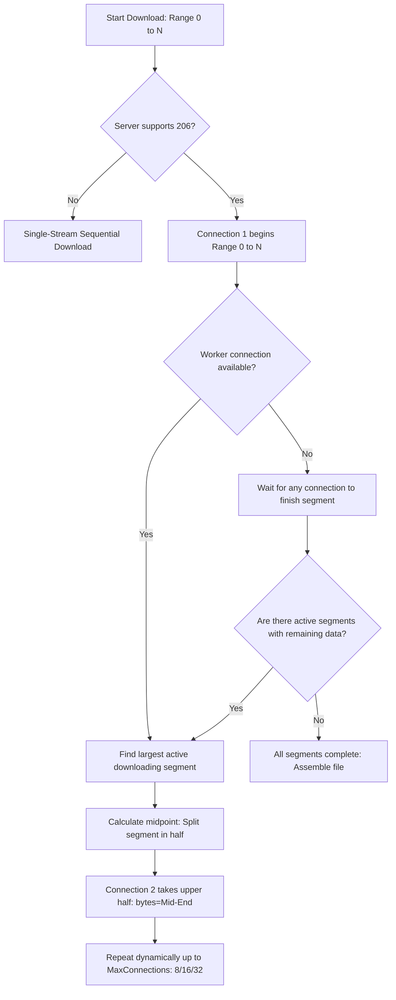
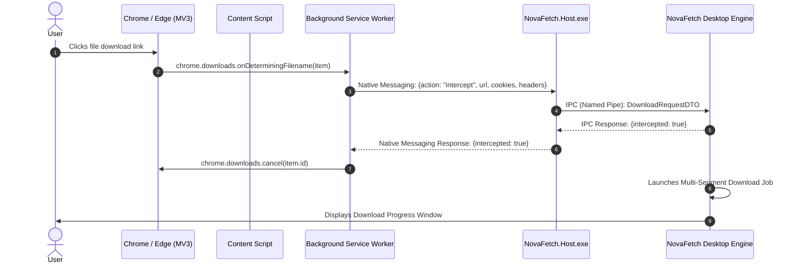

# Complete Feature Inventory & Functional Specification

**Project:** NovaFetch Reverse Engineering & Architecture Specification (Phase 1)  
**Target Analyzed:** Internet Download Manager (IDM v6.42)  
**Output Document:** Exhaustive Functional & Observable Feature Inventory  

---

## 1. User Interface (UI) Subsystem

### 1.1 Main Window Layout & Structure
* **What the User Sees:** A classic dual-pane desktop window with a top menu bar (`Tasks`, `File`, `Downloads`, `View`, `Help`), a prominent icon toolbar directly beneath, a left-side Category and Queue tree, and a right-side virtualized tabular download grid. A bottom status bar displays queue states and background worker activity.
* **Trigger:** Launching `IDMan.exe` or restoring from the Windows system tray.
* **Expected Behavior:** Restores last saved window dimensions and column widths from user preferences. Populates the download grid based on the currently selected category or queue node.
* **State Transitions:** Window states include Normal, Maximized, Minimized to Taskbar, and Minimized to Tray.
* **Errors & Edge Cases:** Multi-monitor DPI change; display disconnection while window is off-screen (requires clamping window coordinates to current virtual screen bounds).
* **NovaFetch Independent Implementation:** Modern WPF window using Fluent Design (`Wpf.Ui` or custom styled templates), with a split `Grid` holding a `TreeView` on the left and a virtualized `DataGrid` on the right. Window state and column widths persist in a local SQLite settings table.

### 1.2 Categories & Navigation Tree
* **What the User Sees:** A hierarchical tree view with the following nodes:
  * `Categories`:
    * `All Downloads` (Aggregated view)
    * `Compressed` (e.g., `.zip`, `.rar`, `.7z`, `.tar`, `.gz`, `.iso`)
    * `Documents` (e.g., `.pdf`, `.doc`, `.docx`, `.xls`, `.xlsx`, `.txt`)
    * `Music` (e.g., `.mp3`, `.wav`, `.flac`, `.aac`, `.ogg`)
    * `Programs` (e.g., `.exe`, `.msi`, `.bat`, `.cmd`)
    * `Video` (e.g., `.mp4`, `.mkv`, `.avi`, `.mov`, `.flv`, `.ts`)
  * `Unfinished` (Active, paused, queued, or interrupted downloads)
  * `Finished` (Completed downloads with valid target files)
  * `Grabber Projects` (Batch website crawler project containers)
  * `Queues`:
    * `Main download queue`
    * `Synchronization queue`
    * User-defined custom queues
* **Trigger:** Selecting any tree node via mouse click or keyboard navigation (Up/Down arrow keys).
* **Expected Behavior:** Filters the tabular list instantly to display only downloads matching the selected category filter, completion state, or queue membership.
* **State Transitions:** `SelectedCategoryChanged` triggers an instantaneous database query or Linq `ICollectionView.Filter` refresh.
* **Errors & Edge Cases:** Renaming or deleting custom queues while jobs are actively processing; downloads with unrecognized extensions (assigned to `General` / `All Downloads`).
* **NovaFetch Independent Implementation:** MVVM `CategoryTreeViewModel` bound to a hierarchical `ObservableCollection<CategoryNode>`. Category definitions (name, icon, file-extension regex pattern, default directory) are fully user-customizable in SQLite.

### 1.3 Download List Columns
* **What the User Sees:** A data grid with user-reorderable and sortable columns:
  1. `File Name`: Name of the target file, accompanied by the associated Windows shell file-type icon.
  2. `Size`: Human-readable size (e.g., `14.25 MB`, `1.42 GB`) or `Unknown` for unmeasured streaming downloads.
  3. `Status`: Text status (e.g., `Downloading`, `Paused`, `Completed`, `Error`, `Connecting`, `Rebuilding`, `Queued`).
  4. `Time Left`: Estimated remaining duration formatted as `hh:mm:ss`.
  5. `Transfer Rate`: Current rolling throughput (e.g., `5.42 MB/s`).
  6. `Last Try Date`: Timestamp of the most recent connection attempt.
  7. `Description`: User-supplied notes or automated referrer URLs.
  8. `Q` (Queue Flag): Visual indicator depicting queue association (3 yellow files = Main Queue; 2 yellow files = Custom Queue; 3 green files = Synchronization Queue).
* **Trigger:** Populated dynamically as download jobs enter the system. Clicking a column header toggles ascending/descending sort.
* **Expected Behavior:** High-performance, 60fps UI updates without stuttering, even with hundreds of active items.
* **NovaFetch Independent Implementation:** WPF `DataGrid` with `VirtualizingStackPanel.IsVirtualizing="True"` and `VirtualizingPanel.VirtualizationMode="Recycling"`. Background data updates occur on a dedicated timer dispatching batched DTO updates to the UI thread at 10 Hz (every 100ms) to eliminate dispatcher saturation.

### 1.4 Download Progress Dialog
* **What the User Sees:** A dedicated popup window for an active download containing:
  * File name, destination folder, URL, Content-Type, and Resume capability indicator (`Yes` / `No`).
  * Overall progress bar and percentage (`0%` to `100%`).
  * Graphical Segment Display: A multi-colored segmented horizontal bar showing individual dynamic chunks actively filling from left to right.
  * Real-time metrics: Downloaded bytes / Total bytes, current transfer speed, elapsed time, remaining time.
  * Tab 2: "File info" (server response headers, ETag, Last-Modified, resolved IP).
  * Tab 3: "Options on completion" (checkboxes for "Hang up when done", "Turn off computer when done", "Exit IDM").
  * Action buttons: `Pause`, `Cancel`, `Hide` (minimizes back to main list).
* **Trigger:** Triggered when a new download starts, or by double-clicking an active download in the main list.
* **Expected Behavior:** Updates fluidly in real time; closing the dialog does not cancel the download (it runs in the background).
* **NovaFetch Independent Implementation:** WPF Window `DownloadProgressWindow` hosting a custom-drawn `SegmentProgressCanvas` using WPF `DrawingContext` for high-performance segment chunk visualization without child element bloat.

### 1.5 Add URL Dialog
* **What the User Sees:** A modal dialog with an input box pre-filled with the current Windows clipboard content if it resembles a valid HTTP/HTTPS URL. Includes fields for Referrer URL, Login/Password (for HTTP Basic / Digest authentication), and a "Download Later" checkbox.
* **Trigger:** Clicking `Add URL` toolbar button, pressing `Ctrl + N`, or clicking a browser context-menu link.
* **Expected Behavior:** Validates URL syntax immediately. If valid, queries server headers via `HEAD` or ranged `GET` to probe file name and size before showing the confirmation dialog.
* **NovaFetch Independent Implementation:** `AddDownloadDialog` in WPF with regex URL validation, automated clipboard URL sniffing, and asynchronous background pre-flight probing.

---

## 2. Download Engine Subsystem

### 2.1 HTTP & HTTPS Protocol Handling
* **Standard Conformance:** Fully conforms to RFC 9110 (HTTP Semantics) and RFC 9112 (HTTP/1.1 Framing).
* **Redirect Resolution:** Automatically follows HTTP `301 Moved Permanently`, `302 Found`, `303 See Other`, `307 Temporary Redirect`, and `308 Permanent Redirect` up to a configurable maximum hop limit (default: 10). Preserves or updates cookie and authorization contexts according to RFC 9110 §15.4 security rules.
* **TLS Negotiation:** Supports TLS 1.2 and TLS 1.3 with standard Windows Certificate Store validation.

### 2.2 Filename Detection Algorithm
Server-suggested filenames are determined using the following prioritized fallback hierarchy:
1. `Content-Disposition` header with RFC 5987 / RFC 6266 encoding (`filename*=UTF-8''...`).
2. Standard `Content-Disposition: attachment; filename="..."`.
3. The terminal path segment of the final resolved URL (post-redirects), stripped of query parameters and URL fragments.
4. Fallback based on `Content-Type` MIME sniffing (e.g., `application/pdf` -> `download.pdf`, `video/mp4` -> `video.mp4`).
5. Generic default: `unnamed_download.dat`.

### 2.3 Dynamic File Segmentation Architecture
Unlike legacy download managers that split a file into static pre-computed blocks prior to downloading, IDM’s hallmark is **Dynamic In-Flight Segmentation**:

#### Detailed Segmentation Rules:
1. **Dynamic Mid-Point Splitting:** When an idle connection slot becomes available and the maximum connection limit has not been reached, the engine evaluates all currently active downloading segments. It selects the segment with the largest remaining byte distance `(EndOffset - CurrentOffset)`.
2. If that remaining distance exceeds a configurable minimum split threshold (default: 512 KB), the segment is sliced precisely at its midpoint:
   $$\text{Midpoint} = \text{CurrentOffset} + \left\lfloor \frac{\text{EndOffset} - \text{CurrentOffset}}{2} \right\rfloor$$
   The existing connection continues downloading `CurrentOffset` through `Midpoint - 1`, while the newly spawned connection issues a ranged request for `Midpoint` through `EndOffset`.
3. **Connection Reuse & Zero-Overhead Switching:** When a connection finishes its assigned byte range, it is not torn down. Instead, the persistent HTTP keep-alive socket immediately executes a split on another lagging segment.
4. **Fallback on Non-Range Servers:** If the remote server returns `200 OK` instead of `206 Partial Content`, or if the server explicitly declares `Accept-Ranges: none`, the engine flags the download as non-resumable and falls back to a single uninterrupted stream.

### 2.4 Temporary File Storage & Reassembly
1. **Segment Directory:** Active chunks are isolated in a temporary folder: `%LOCALAPPDATA%\NovaFetch\Temp\<DownloadGuid>\`.
2. **Chunk Part Files:** Individual workers write directly to unbuffered or buffered temporary part files: `segment_0.tmp`, `segment_1.tmp`, etc. Each chunk maintains an in-memory and on-disk atomic offset marker.
3. **Safe File Assembly (Stitching):**
   * Once all segments report `State == Completed`, the engine enters the `Rebuilding` state.
   * It creates the destination file in the target directory (e.g., `C:\Users\Username\Downloads\Video\archive.zip`).
   * It streams chunks in sequential order (`segment_0.tmp` -> `segment_1.tmp` -> ...) into the final file using an 8 MB high-throughput buffer or direct Windows file-mapping API (`CreateFileMapping` / `MapViewOfFile`).
   * Upon successful byte verification, temporary chunk files and the temporary directory are deleted.

### 2.5 Resumption & Cache Validation
When resuming an interrupted or paused download:
* The engine sends an HTTP request with conditional headers:
  * `If-Range: <ETag>` (or `If-Range: <Last-Modified>`)
  * `Range: bytes=<Offset>-`
* **Handling Responses:**
  * If the server responds with `206 Partial Content`, the ETag/timestamp is valid; the download safely resumes from the saved byte offsets.
  * If the server responds with `200 OK`, the remote resource has been modified. The engine must discard existing temporary segments and restart the download from byte 0 to prevent data corruption.
  * If the server responds with `416 Range Not Satisfiable`, the file offsets are invalid or the remote file size has changed.

---

## 3. Queue and Scheduling Subsystem

### 3.1 Queue Archetypes
1. **Main Download Queue:**
   * Intended for general file downloading.
   * Items are processed sequentially or concurrently up to the queue's configured concurrency limit (default: 1 concurrent download).
   * Once a job completes, it is removed from the queue and moved to the "Finished" category.
2. **Synchronization Queue:**
   * Intended for recurring file sync operations.
   * Checks remote server timestamps (`Last-Modified`) and `ETag` headers. If the file on the server has changed, it is re-downloaded and overwrites the local copy.
   * Items remain in the queue permanently after processing.
3. **User-Defined Custom Queues:**
   * Fully configurable queues (e.g., "Night Queue", "Software Updates") with independent scheduling schedules, speed limits, and concurrency caps.

### 3.2 Scheduler Timing & Post-Processing
* **Start Conditions:** Can be triggered manually, on application launch, or at a specific scheduled time (e.g., `02:00:00 AM`).
* **Repetition:** One-time execution, daily, or specific days of the week.
* **Stop Conditions:** Automatic stop when all queue items complete, or at a hard deadline (e.g., `06:00:00 AM`).
* **Automated Post-Tasks:**
  * Disconnect dial-up/VPN connection.
  * Shut down computer (`ExitWindowsEx` with `EWX_SHUTDOWN`).
  * Force close running processes (`EWX_FORCEIFHUNG`).
  * Sleep / Hibernate workstation (`SetSuspendState`).
  * Execute external batch file or executable.

---

## 4. Browser Integration Subsystem

### 4.1 Architecture & Protocols
Modern Chromium browsers (Google Chrome, Microsoft Edge, Brave, Opera, Vivaldi) enforce **Manifest V3 (MV3)**. The architecture consists of:
1. **Browser Extension (Manifest V3):** Background service worker, content scripts, and declarative rules.
2. **Native Messaging Bridge (`NovaFetch.Host.exe`):** A lightweight native Windows console application registered in the Windows Registry.
3. **Main Desktop Application (`NovaFetch.exe`):** The primary UI and multi-connection download engine.

### 4.2 Interception Mechanics in Manifest V3
Because Manifest V3 removes blocking `chrome.webRequest.onHeadersReceived`, interception is achieved through a multi-layered hybrid strategy:
1. **Download Interception:** The extension registers `chrome.downloads.onDeterminingFilename`. When a download starts, the extension checks if the file extension or MIME type is claimed by NovaFetch. If claimed, the extension sends the download parameters (URL, cookies via `chrome.cookies`, Referrer, User-Agent) to the native host, and cancels Chrome's built-in download via `chrome.downloads.cancel()`.
2. **Video & Stream Sniffing:**
   * Non-blocking `chrome.webRequest` (permitted in MV3 without blocking flags) passively monitors media requests (`.m3u8`, `.mpd`, `.ts`, `.mp4`, `.webm`).
   * A content script injected into web pages monitors HTML5 `<video>` and `<audio>` elements, observing `src` attribute mutations and `HTMLMediaElement.play` events.
3. **Floating Video Panel:**
   * The content script overlays a discreet "Download Video" button in the upper-right corner of detected media elements.
   * Clicking the button opens a dropdown displaying available streams, bitrates, and video resolutions.

### 4.3 Boundaries & DRM Restrictions
* **DRM Protection:** Protected media encrypted using Widevine, FairPlay, or PlayReady Encrypted Media Extensions (EME) **cannot** and **must not** be decrypted or intercepted.
* When NovaFetch detects encrypted media initialization (`mediaKeys` or Common Encryption `cenc` PSSH atoms), it gracefully indicates to the user that the content is copy-protected and cannot be captured.

---

## 5. Windows Integration Subsystem

### 5.1 Shell Integration & Context Menus
* **Shell Associations:** Registers file extensions and URL protocols (`novafetch://`) in `HKEY_CURRENT_USER\Software\Classes`.
* **System Tray & Toast Notifications:**
  * Background icon in Windows System Tray (`Shell_NotifyIconW`) with a context menu (`Resume All`, `Stop All`, `Speed Limiter`, `Exit`).
  * Native Windows 10/11 Toast Notifications via Microsoft's `Microsoft.Toolkit.Uwp.Notifications` / Windows App SDK for "Download Complete" and "Download Failed" events.
* **Clipboard Monitoring:**
  * Uses the modern Win32 API `AddClipboardFormatListener` to receive `WM_CLIPBOARDUPDATE` messages.
  * Checks clipboard text against regex URL patterns. If an image or media link matches the extension filter, it presents a subtle slide-in toast or Add Download dialog.

---

## 6. Settings and Preferences Inventory

Below is the complete reference inventory of all configurable settings, directly modeled from IDM's 9-tab configuration interface:

| Tab | Setting Name | Purpose | Verified Default | Allowed Values | NovaFetch Implementation Plan |
|:---|:---|:---|:---|:---|:---|
| **General** | `LaunchOnStartup` | Start NovaFetch when Windows boots | `true` | `true`, `false` | Registry `HKCU\Software\Microsoft\Windows\CurrentVersion\Run` |
| **General** | `IntegrateBrowsers` | Intercept downloads from Chrome/Edge | `true` | `true`, `false` | Register/unregister Native Messaging manifests |
| **General** | `MonitorClipboard` | Sniff copied URLs automatically | `true` | `true`, `false` | Win32 `AddClipboardFormatListener` |
| **General** | `KeysSpecialCapture` | Shortcut key to force download | `Ins` | `Alt`, `Ctrl`, `Shift`, `Ins` | Global low-level keyboard hook |
| **File Types** | `AutomaticallyDownloadExtensions` | Space-delimited extensions to intercept | `3GP 7Z AAC ACE AIF ARJ ASF AVI BIN BZ2 EXE GZ ISO LZH M4A M4V MKV MOV MP3 MP4 MPA MPE MPEG MPG MSI MSU OGG OGV PDF PLJ PPS PPT PPTX QT R0* R1* RA RAR RM RMOV RMVB SEA SIT SITX TAR TIF TIFF TS WAV WMA WMV Z ZIP` | String of file extensions | SQLite `Settings` table; parsed into `HashSet<string>` |
| **File Types** | `ExcludedServers` | Sites where interception is disabled | Empty | List of domain regexes | Match `Uri.Host` before initiating interception |
| **Save To** | `DefaultDownloadDir` | Default folder for unclassified items | `%USERPROFILE%\Downloads` | Valid Windows directory path | `System.IO.Path` validation |
| **Save To** | `CategoryPaths` | Custom folders for Video, Music, etc. | `%USERPROFILE%\Downloads\<Category>` | Map of Category -> Path | SQLite `Categories` table |
| **Save To** | `TemporaryDir` | Scratch directory for raw segments | `%LOCALAPPDATA%\NovaFetch\Temp` | Valid local drive path | Ensure directory has write permissions |
| **Downloads** | `ShowStartDownloadDialog` | Show dialog asking where to save | `true` | `true`, `false` | WPF Dialog prompt |
| **Downloads** | `ShowCompleteDialog` | Show dialog when download finishes | `true` | `true`, `false` | WPF Dialog prompt |
| **Downloads** | `VirusScannerPath` | Executable to scan finished files | Empty / Windows Defender | Executable path | `Process.Start` with target file argument |
| **Connection** | `ConnectionSpeedType` | Network bandwidth classification | `High speed (Direct connection)` | `Low`, `Medium`, `High` | Configures buffer sizes |
| **Connection** | `MaxConnectionsPerDownload` | Maximum dynamic connections per job | `8` | `1, 2, 4, 8, 16, 24, 32` | `SemaphoreSlim` throttler in `DownloadEngine` |
| **Connection** | `SpeedLimiterEnabled` | Global or per-download speed throttling | `false` | `true`, `false` | Token-bucket rate limiter |
| **Connection** | `SpeedLimiterValue` | Max transfer rate in KB/s | `500` | Integer > 0 | Token-bucket refill rate |
| **Proxy/Socks** | `ProxyType` | Proxy protocol | `None` / `Use System Settings` | `None`, `HTTP`, `HTTPS`, `SOCKS4`, `SOCKS5` | `SocketsHttpHandler.Proxy` property |
| **Site Logins** | `AuthenticationCredentials` | Stored credentials for protected sites | Empty | Host, Username, Encrypted Password | Windows DPAPI protected password storage |
| **Sounds** | `PlaySoundOnComplete` | Audio chime on download complete | `true` | `true`, `false` | SoundPlayer playing Windows theme WAV |

---

## 7. Error Taxonomy and Reliability Strategy

| Error Condition | HTTP / Win32 Cause | Observable Behavior | NovaFetch Recovery Strategy |
|:---|:---|:---|:---|
| **DNS Resolution Failure** | `SocketError.HostNotFound` | UI reports "Host not found" | Retry 3 times with exponential backoff (2s, 4s, 8s); prompt user if unreachable. |
| **Connection Timeout** | `TaskCanceledException` | Socket read exceeds 15s | Abort stalled segment; retry segment on existing connection pool. |
| **Connection Reset** | `SocketError.ConnectionReset` | Remote peer forcibly closes socket | Re-establish TLS handshake; resume from last verified chunk offset. |
| **HTTP 401 Unauthorized** | Missing or invalid credentials | Dialog prompts for username/password | Prompt user with authentication modal; attach `Authorization` header. |
| **HTTP 403 Forbidden** | Temporary token expired or anti-leech | Download halts immediately | Report token expiration; allow user to "Refresh Download Address". |
| **HTTP 404 Not Found** | URL removed or dead link | Download transitions to `Failed` | Mark job permanently failed with clear error message; do not retry. |
| **HTTP 416 Range Not Satisfiable** | File changed or offset exceeds file | Segment request rejected | Validate remote ETag/Content-Length; if file changed, offer full restart. |
| **HTTP 429 Too Many Requests** | Server rate limiting / IP block | Connection throttled or blocked | Read `Retry-After` header; throttle active connections down to 1. |
| **HTTP 500 / 502 / 503** | Server-side transient error | Temporary failure | Exponential backoff retry with jitter (max 5 attempts). |
| **Disk Full Error** | `ERROR_DISK_FULL` (0x70) | Write operation throws I/O exception | Pause download immediately; notify user with desktop alert; resume when space freed. |
| **File Lock / Access Denied** | `ERROR_SHARING_VIOLATION` | Antivirus locks final file | Retry atomic rename up to 5 times with 500ms delay. |
| **Corrupted Chunk Data** | Incomplete buffer flush on crash | Byte discrepancy during reassembly | Validate chunk length against metadata; re-download corrupted chunk range only. |
